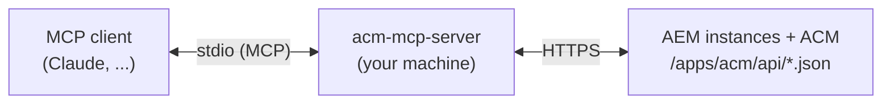

# ACM MCP Server

[](https://www.npmjs.com/package/@wppes/acm-mcp-server)
[](https://github.com/wttech/acm/actions/workflows/release.mcp-server.yml)

A [Model Context Protocol](https://modelcontextprotocol.io) server that connects AI agents (Claude Code, Claude Desktop, VS Code, Cursor and other MCP clients) to [AEM Content Manager (ACM)](https://github.com/wttech/acm) running on Adobe Experience Manager, including AEM as a Cloud Service.

An agent can validate and run Groovy scripts on AEM through ACM, follow long-running executions, read execution history and console output, and browse the scripts stored on the instance — on any of the configured instances, so it can also compare author against publish or against another environment. Every call runs as the user whose credentials you configure.



> [!WARNING]
> This server lets an AI agent run arbitrary Groovy code on AEM with your permissions. Read [Security](#security) before pointing it at a shared or production instance.

> [!TIP]
> Using VS Code? The [ACM extension](../vscode-extension/README.md) bundles this server and registers it for all enabled instances, with credentials from VS Code's secret storage. No setup below is needed — and **ACM: Export MCP Config** writes a ready config file for other agents.

## Requirements

- Node.js 22 or later.
- ACM installed on each AEM instance. Running code without history (`history: false`) needs ACM 0.9.74 or later.
- A user with access to the ACM API on each instance (see [Permissions](#permissions)).

## Setup

The server is configured by a JSON document using the same keys as the VS Code extension settings, including the `acm.` prefix — a block copied from `settings.json` is a valid config:

```json
{
  "acm.instances": [
    { "name": "local-author", "url": "http://localhost:4502", "authMode": "basic", "user": "admin" },
    { "name": "local-publish", "url": "http://localhost:4503", "authMode": "basic", "user": "admin" },
    { "name": "dev", "url": "https://author-pXXXX-eYYYY.adobeaemcloud.com", "authMode": "bearer",
      "secret": { "env": "ACM_DEV_TOKEN" }, "readonly": true },
    { "name": "prod", "url": "https://author.example.com", "authMode": "cookie",
      "secret": { "file": "~/.config/acm/prod.cookie" }, "enabled": false }
  ],
  "acm.activeInstance": "local-author",
  "acm.http.timeout": 30000,
  "acm.run.timeout": 120000,
  "acm.run.pollInterval": 1000
}
```

The timeout keys are optional; their defaults are shown. Unknown keys are ignored, so a whole settings block can be pasted.

### 1. Create the config file

Instance fields:

| Field | Description |
|---|---|
| `name` | Unique name; tools take it as the optional `instance` argument. |
| `url` | AEM URL, author or publish, e.g. `http://localhost:4502`. |
| `authMode` | `bearer`, `cookie` or `basic`. |
| `user` | Basic-auth user (required for `basic`). |
| `secret` | The credential — see [Secrets](#secrets). Omitted for a local `admin`/`admin` SDK. |
| `readonly` | `true` disables the tools that run or abort code on this instance. Recommended for production; see [Security](#security). |
| `enabled` | `false` hides the instance from all tools, e.g. to park prod temporarily (default `true`). |

Choosing credentials:

| `authMode` | When to use | How to get the secret |
|---|---|---|
| `bearer` | AEM as a Cloud Service (recommended) | Cloud Manager → Developer Console of the environment → Integrations → Local token → "Get Local Development Token". Valid for 24 hours and acts as your user. |
| `cookie` | AEM as a Cloud Service, quick start; any instance you can log into | Value of the `login-token` cookie (DevTools → Application → Cookies) after logging into AEM. CSRF tokens are handled for you. |
| `basic` | Local AEM SDK, on-premise | Usually `admin` / `admin`. |

The `login-token` cookie expires after about 12 hours; use `secret: { "file": "path" }` to refresh it without restarting the server.

#### Secrets

`secret` is the bearer token, the `login-token` cookie (value or `name=value`) or the basic-auth password, given as:

- a literal — convenient for development. Keep the config file readable only by you (`chmod 600`); the server warns when it is not.
- `{ "env": "NAME" }` — read from an environment variable when the server starts.
- `{ "file": "path" }` — `~` is expanded and a relative path resolves against the config file. Re-read on **every** request, so refreshing a token on disk needs no restart. A missing or empty file fails only that instance.

Basic auth with user `admin` on a local URL defaults to password `admin`, so the local SDK needs no secret at all.

### 2. Register the server with your agent

Every MCP client needs the same things. Where they go and in which format depends on the client, so this guide does not list client-specific files:

| Setting | Value |
|---|---|
| Transport | stdio |
| Command | `npx` |
| Arguments | `-y`, `@wppes/acm-mcp-server` |
| Environment | `ACM_CONFIG_FILE` with the path from step 1 |

Instead of `ACM_CONFIG_FILE` you can pass the document inline as `ACM_CONFIG`; it takes precedence over the file.

The easiest way is to ask your agent, which knows its own configuration:

> Add the ACM MCP server to this tool's MCP configuration: transport stdio, command `npx`, arguments `-y @wppes/acm-mcp-server`, environment `ACM_CONFIG_FILE` pointing at a JSON file with the ACM instances I list below. Keep secrets out of that file — reference environment variables or files instead — and never write them into a file that may be committed; tell me where to put the values. Find in this tool's documentation where MCP servers are configured and in which format. Then call `acm_list_instances` and `acm_health` to verify.

### 3. Check the connection

Ask the agent to call `acm_list_instances`, then `acm_health`. The first shows every enabled instance with its auth mode and whether credentials are configured; the second reports the state ACM reports for each of them.

## Instances

Tools act on exactly one instance, chosen like this:

1. the optional `instance` argument, when given — it must name an enabled instance;
2. otherwise `acm.activeInstance`, when it names an enabled instance;
3. otherwise the only enabled instance, when just one is configured;
4. otherwise the call fails with the list of enabled names, so nothing runs on the wrong instance by accident.

`acm_list_instances` shows which instance is active and which have credentials. Write tools (`acm_run_code`, `acm_abort_execution`, `acm_describe_inputs`) always act on exactly one instance — there is deliberately no run-everywhere call. To compare instances (e.g. author vs publish drift), run the same read-only code on each and diff the results; the bundled scripting guide covers the pattern. This needs ACM reachable on both sides, which works on local, on-premise and AMS (direct publish URL) — an AEMaaCS publish is not reachable.

## Tools

| Tool | Description |
|---|---|
| `acm_list_instances` | List the enabled instances: name, URL, auth mode, read-only flag, the active one and whether credentials are configured. |
| `acm_health` | Check connectivity, auth and the instance state ACM reports (`/apps/acm/api/state.json`), with a warning when ACM's health check finds the instance unhealthy. Without `instance`, checks every enabled instance. Call it first. |
| `acm_validate_code` | Compile-check Groovy without running it (`mode=parse`). Returns compile errors with line and column. Never recorded in execution history. |
| `acm_run_code` | Queue Groovy for execution, poll until it finishes or times out, and return the status and full console output. Supports `inputs` for scripts with `describeRun()`. With `history: false` it runs synchronously and is not recorded in history (see below). |
| `acm_get_execution` | Get the status, inputs, error and console output of an execution by ID, whether queued, running or archived. |
| `acm_abort_execution` | Abort a queued or running execution. Scripts that call `context.checkAborted()` stop cleanly. |
| `acm_list_executions` | List execution history, newest first, optionally only queued and running executions. |
| `acm_list_scripts` | List Groovy scripts stored under `/conf/acm/settings/script` by type (MANUAL, AUTOMATIC, …). |
| `acm_get_script` | Read the Groovy content of a stored script by ID or path. |
| `acm_describe_inputs` | Resolve the inputs a script declares in `describeRun()`: names, types and defaults. ACM runs `describeRun()` to do this, so it counts as running code. |
| `acm_get_output_file` | Download a named execution output: `console`, or an output created with `outputs.file(...)` / `outputs.text(...)`. |

Every tool takes an optional `instance` argument; see [Instances](#instances) for the default.

Bare Groovy snippets are wrapped in the `canRun()`/`doRun()` structure automatically, so `println "hello"` is valid input for `acm_validate_code` and `acm_run_code`.

### Runs without history

Every queued run is stored in ACM execution history, so iterating on a script quickly fills it up. With `history: false`, `acm_run_code` calls `/apps/acm/api/execute-code.json` directly and the run is not recorded. Such a run:

- has no execution ID to poll or abort, and keeps no output files;
- is cut off on the client side after `waitMs`, while the script may keep running on AEM.

Use it for short read-only runs or dry runs while you develop a script. Run the final version, and anything that changes content, with the default `history: true` so the change stays auditable.

Running without history needs the `console/execute/nohistory` ACM feature (administrators only by default); without it the call fails with `403`. Such runs still appear in ACM's [audit log](https://github.com/wttech/acm#audit-log).

## Scripting guide

The server ships the [ACM Groovy scripting skill](../skills/acm-groovy-script/SKILL.md), so agents write valid, safe scripts without extra setup:

- **Instructions.** The skill's essentials (never invent API, dry runs, abort checks, validate before running) are sent to the client when it connects. Clients add them to the model's context.
- **Prompt.** `acm-groovy-script` returns the full guide.
- **Resources.** The guide and its references are available as `acm://skill/SKILL.md`, `acm://skill/references/api.md` (every ACM variable, class and method, generated from the ACM source), `acm://skill/references/scripts.md` and the script templates under `acm://skill/templates/`.

## Example

Ask the agent something like:

> Use ACM to count how many `wknd/components/teaser` components are under `/content/wknd/us/en`.

It calls `acm_health`, then validates and runs a script such as:

```groovy
boolean canRun() {
    return conditions.always()
}

void doRun() {
    def sql = "SELECT * FROM [nt:base] AS n WHERE ISDESCENDANTNODE(n, '/content/wknd/us/en') AND n.[sling:resourceType] = 'wknd/components/teaser'"
    def count = 0
    repo.queryRaw(sql).forEach { resource ->
        context.checkAborted()
        count++
    }
    out.info("Found ${count} instance(s)")
}
```

## Permissions

ACM checks access at three levels. The user behind the credentials needs `jcr:read` on each:

1. the API node under `/apps/acm/api`;
2. the feature node under `/apps/acm/feature`;
3. the script path under `/conf/acm/settings/script`.

By default only administrators have access. See [Tools Access Configuration](https://github.com/wttech/acm#tools-access-configuration). A `403` from any tool includes this hint. A `401` means the token or cookie has expired.

## Security

- **The agent acts as you.** Every script runs with the permissions of the configured user. A model can make mistakes, and content it reads (pages, scripts, execution output) can try to steer it. Use the least-privileged user that can do the job.
- **Mark production instances `readonly`.** Health, validation, history and script-reading tools keep working; running, describing and aborting code are blocked on that instance. This only stops the agent from calling those tools. It is not a security boundary: validation still compiles the submitted Groovy on AEM, and Groovy compile-time transforms can run code. The real control is the AEM permissions of the configured user. `enabled: false` hides an instance entirely.
- **Runs are traceable.** Queued runs are kept in ACM history; runs that leave no history (without history, or not queued by `canRun()`) are written to ACM's [audit log](https://github.com/wttech/acm#audit-log) with the user and a checksum of the code. Grant `console/execute/nohistory` only to users who need it.
- **Grant agents only what they need.** A user with the `script/execute` feature but without `console/execute` can only run the stored scripts as they are.
- **Review scripts before they run** against shared instances. Don't auto-approve `acm_run_code` in your MCP client for those instances.
- **Prefer dry runs for destructive changes.** Use ACM's `repo.dryRun(...)` pattern; the bundled scripting guide steers the model towards it.
- **Credentials stay local.** The server runs on your machine and only talks to the configured instance URLs. Prefer `{ "env" }` and `{ "file" }` secret references, or keep literal secrets in a `chmod 600` config file — never in files you commit.

## Contributing

To build, test and release the server, see the [development guide](https://github.com/wttech/acm/blob/main/tools/mcp-server/DEVELOPMENT.md).

## License

Part of AEM Content Manager, licensed under the [Apache License, Version 2.0](https://github.com/wttech/acm/blob/main/LICENSE). Provided "as is", without warranty of any kind; use it at your own risk (see sections 7 and 8 of the license).
